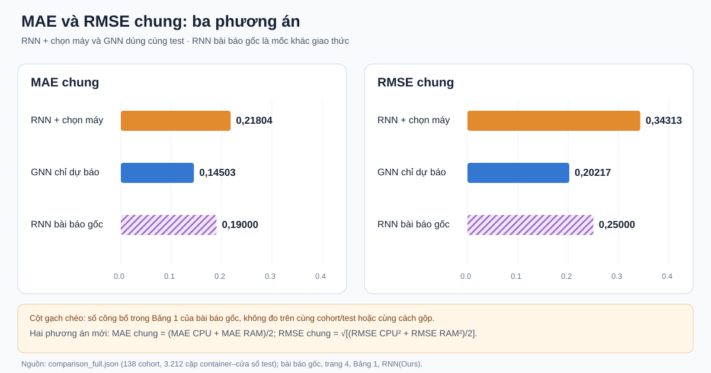
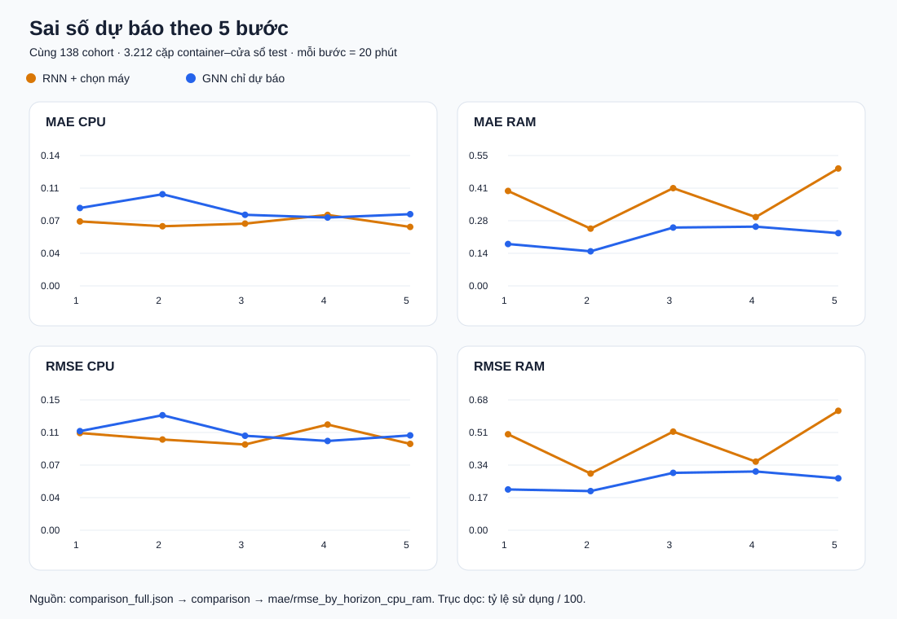
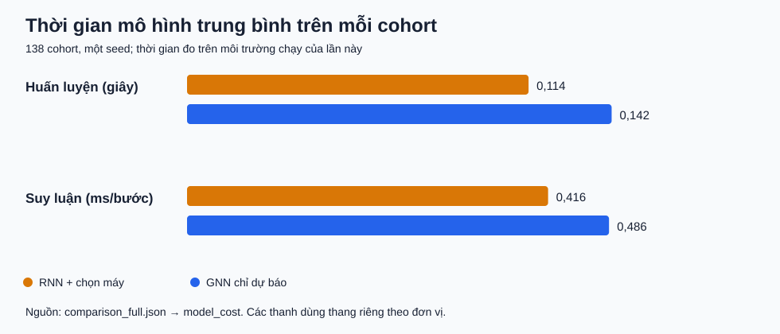

# Báo cáo: RNN + chọn máy và GNN chỉ dự báo

Trace có nhiều container xuất hiện và biến mất ở các thời điểm khác nhau; nếu đưa tất cả vào một đồ thị duy nhất, phần lớn nút sẽ thiếu lịch sử hoặc nhãn ở một bước dự báo cụ thể. Chia thành cohort (nhóm container có khoảng quan sát chồng nhau) giúp tạo được mẫu đồng bộ để huấn luyện và so sánh RNN với GNN trên cùng dữ liệu.
Lần chạy báo `complete: true`, gồm **138 cohort**, **551 container duy nhất**, **3.212 cặp container–cửa sổ test**. 33.519 container xuất hiện trong các khoảng xét; 25.214 đạt ngưỡng độ phủ train ở ít nhất một khoảng. Quét hết trace không đồng nghĩa mọi container đều được đánh giá.

## Tổng quan ba phương án

| Phương án | MAE CPU | MAE RAM | RMSE CPU | RMSE RAM | MAE/RMSE chung | 
|---|---:|---:|---:|---:|---|
| RNN + thuật toán chọn máy | 0,06795 | 0,36812 | 0,10754 | 0,47320 | MAE: 0,21804; RMSE: 0,34313 |
| GNN chỉ dự báo | 0,08179 | 0,20828 | 0,11387 | 0,26226 | MAE: 0,14503; RMSE: 0,20217 | 
| **RNN bài báo gốc** | Không tách | Không tách | Không tách | Không tách | **MAE 0,190; RMSE 0,250** |

Với hai phương án phát triển: `MAE chung = (MAE CPU + MAE RAM) / 2`; `RMSE chung = sqrt((RMSE CPU² + RMSE RAM²) / 2)`. 

## Sai số dự báo

| Phương án | MAE CPU | RMSE CPU | MAE RAM | RMSE RAM |
|---|---:|---:|---:|---:|
| RNN + thuật toán chọn máy | 0,06795 | 0,10754 | 0,36812 | 0,47320 |
| GNN chỉ dự báo | 0,08179 | 0,11387 | 0,20828 | 0,26226 |

**Cách tính:** MAE tổng hợp là trung bình của 5 `mae_by_horizon_cpu_ram`. RMSE tổng hợp là căn của trung bình 5 bình phương `rmse_by_horizon_cpu_ram`; mỗi horizon trong report đã được gộp có trọng số theo số cặp container–cửa sổ test. Hai phương án dùng cùng cohort và test nên có thể so trực tiếp **sai số dự báo**. Chọn máy không làm thay đổi MAE/RMSE của RNN: các chỉ số này được tính trên dự báo điểm trước khi cộng biên an toàn.

GNN có MAE RAM thấp hơn RNN **43,4%**, nhưng MAE CPU cao hơn **20,4%**. Đây là chênh lệch của lần chạy với một seed; không suy ra GNN tốt hơn toàn diện. Mỗi ô là 20 phút, nên 5 bước dự báo trải 100 phút. Đơn vị sai số là tỷ lệ sử dụng từ CSV chia 100, không phải core hoặc GB.

## Chỉ số chọn máy của RNN

| Chỉ số | Giá trị | Cách hiểu |
|---|---:|---|
| Quá tải | 99,63% | 3.200/3.212 máy–bước đang hoạt động |
| Tổng giờ máy | 1070,67 | Cộng qua các cohort mô phỏng; có thể trùng khoảng thời gian |
| Di chuyển container | 0 | Tổng số lần trong mô phỏng |

**GNN chỉ dự báo không có các chỉ số chọn máy.** Vì vậy không thể dùng bảng này để kết luận RNN + chọn máy hiệu quả hệ thống hơn hoặc kém hơn GNN. Tỷ lệ quá tải gần 100% cho thấy kịch bản mô phỏng gần như bão hòa; tải nền máy bị thiếu 17,34% ô và được điền theo quy tắc của mã. Phép cộng phần trăm tải máy với tải container là giả định mô phỏng, không phải phép đo quá tải thực của cụm Alibaba.

## Chi phí mô hình

| Mô hình | Huấn luyện trung bình ± độ lệch chuẩn (giây/cohort) | Suy luận trung bình ± độ lệch chuẩn (ms/bước) |
|---|---:|---:|
| RNN | 0,1144 ± 0,1014 | 0,4158 ± 0,1107 |
| GNN | 0,1423 ± 0,1218 | 0,4860 ± 0,1798 |

Thời gian GNN cao hơn RNN khoảng **24,3%** khi huấn luyện và **16,9%** khi suy luận trên cohort 4 container. Thời gian này phụ thuộc phần cứng và cách đo.

## Giới hạn diễn giải

Báo cáo tổng hợp 138 cohort đủ điều kiện, không phải toàn bộ 33.519 container. Chỉ một seed được chạy; các cửa sổ và một số container có thể lặp giữa cohort. Cần kiểm tra độ nhạy theo seed, khoảng thời gian, tải nền và dung lượng máy trước khi đưa ra kết luận thống kê hoặc vận hành.

