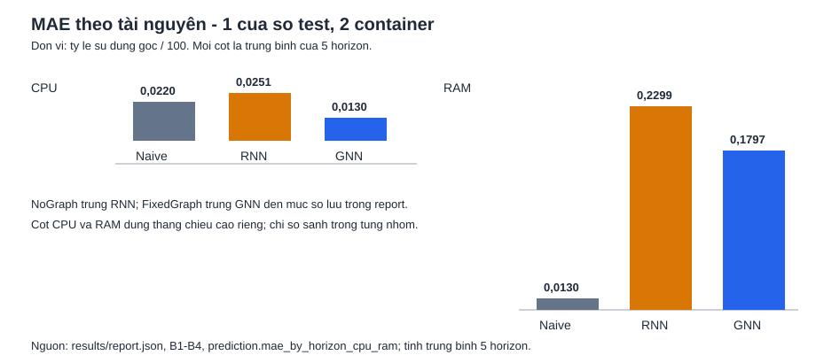
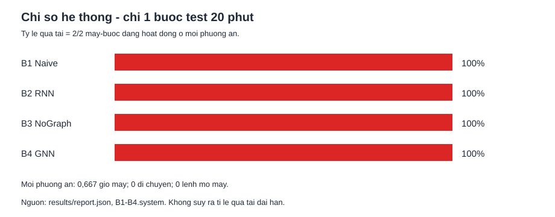

# Báo cáo tổng hợp thí nghiệm dự báo tải và chọn máy

**Nguồn số liệu:** [`report.json`](report.json), tạo bởi `GNN_Host_Selection/run.py`. **Đối chiếu bài báo:** *Time-Series Load Prediction for Cloud Resource Allocation Using Recurrent Neural Networks*, [PDF gốc, trang 4, Bảng 1](../../Time-SeriesLoadPredictionforCloudResourceAllocationUsingRecurrentNeuralNetworks-1.pdf#page=4). Báo cáo này chỉ diễn giải lần chạy đã lưu, không gộp kết quả của các lần chạy khác.

## 1. Tóm tắt kết quả và phạm vi

Lần chạy chọn được **2 container** (`c_31081`, `c_28344`) trong khoảng bắt đầu tại giây **518.400** của trace, dài **86.400 giây (24 giờ)**. Dữ liệu được gom thành 72 ô, mỗi ô **20 phút**, chia theo thời gian 43/14/15 ô cho train/validation/test. Sau khi yêu cầu lịch sử 12 ô và nhãn đủ 5 bước, chỉ còn **2 cửa sổ train, 2 validation và 1 test**. Tỷ lệ ô thiếu của hai container là **5,56%**. Các thông số này lấy trực tiếp từ `start_seconds`, `duration_seconds`, `containers`, `split_indices`, `windows`, `missing_fraction` và `config` trong report.

Với **1 cửa sổ test**, mỗi MAE tại một horizon chỉ dựa trên **2 cặp dự báo–thực tế** (một cho mỗi container). Đây là khảo sát khả năng chạy của pipeline, **chưa phải bằng chứng để trả lời RQ1–RQ3 cho cả cụm Alibaba**.

## 2. Sai số dự báo

| Phương án | MAE CPU | RMSE CPU | MAE RAM | RMSE RAM |
|---|---:|---:|---:|---:|
| B1 · tải gần nhất | 0,0220 | 0,0249 | **0,0130** | **0,0145** |
| B2 · RNN | 0,0251 | 0,0311 | 0,2299 | 0,2786 |
| B3 · NoGraph | 0,0251 | 0,0311 | 0,2299 | 0,2786 |
| B4 · GNN động | **0,0130** | **0,0168** | 0,1797 | 0,1903 |
| Ablation · FixedGraph | **0,0130** | **0,0168** | 0,1797 | 0,1903 |

**Cách suy ra bảng:** `report.json → B1/B2/B3/B4/FixedGraph → prediction`. MAE tổng hợp là trung bình cộng của 5 giá trị `mae_by_horizon_cpu_ram` cho từng tài nguyên. RMSE tổng hợp được tính bằng `sqrt(mean(RMSE_h²))`, vì mỗi horizon có cùng 2 container; không lấy trung bình trực tiếp các RMSE. Đơn vị là tỷ lệ phần trăm sử dụng trong CSV đã **chia 100**, không phải core hay GB. B0 dùng cùng dự báo RNN như B2 nên cùng MAE/RMSE, nhưng B0 không có mô phỏng hệ thống.

So với RNN **trong chính lần chạy này**, MAE CPU của GNN thấp hơn khoảng **48,3%** (`1 − 0,012999/0,025128`), MAE RAM thấp hơn khoảng **21,8%** (`1 − 0,179698/0,229871`). Đây chỉ là phép tính trên 1 cửa sổ test. Mô hình tải gần nhất lại có MAE RAM **0,0130**, thấp hơn cả RNN và GNN; do đó không thể nói GNN là mô hình tốt nhất về mọi tài nguyên trong lần chạy này.

Kết quả B2 và B3 **trùng hoàn toàn** ở độ chính xác lưu trong report; B4 và FixedGraph cũng trùng hoàn toàn. Theo mã `run.py`, RNN và NoGraph dùng cùng GRU/head, cùng seed và không có lớp truyền tin; vì vậy cặp đầu không phải hai kiến trúc độc lập. Sự trùng của cặp GNN/FixedGraph cho thấy **không quan sát được lợi ích của cập nhật cạnh động** trong mẫu này; report không lưu ma trận cạnh nên không thể khẳng định chính xác nguyên nhân chỉ từ tệp kết quả.

## 3. Hiệu quả chọn máy

| Phương án | Quá tải | Giờ máy | Di chuyển | Lệnh mở máy |
|---|---:|---:|---:|---:|
| B1 · tải gần nhất | 100% | 0,667 | 0 | 0 |
| B2 · RNN | 100% | 0,667 | 0 | 0 |
| B3 · NoGraph | 100% | 0,667 | 0 | 0 |
| B4 · GNN động | 100% | 0,667 | 0 | 0 |

**Nguồn và phép tính:** `report.json → B1–B4 → system`. `active_host_steps = 2` ở mỗi phương án. `overload_rate = 1` nghĩa là **2/2 máy–bước đang hoạt động bị quá tải** trong bước test duy nhất; không có nghĩa là toàn cụm Alibaba quá tải 100% trong 24 giờ. `machine_hours = 2 × 20/60 = 0,667`. Mỗi phương án có `migrations = 0`, `boot_requests = 0`. Vì mọi giá trị hệ thống bằng nhau, lần chạy này **không chứng minh dự báo hoặc GNN cải thiện chọn máy**.

Mô phỏng dùng 4 máy (`m_1`, `m_10`, `m_100`, `m_1000`). Dung lượng CPU/RAM sau chuẩn hóa của cả 4 đều bằng `(1, 1)` trong report; `background_missing_fraction = 0`. Mã lấy tỷ lệ dung lượng từ `machine_meta.csv` và hồ sơ tải nền từ `machine_usage_bigger.csv`, loại máy liên quan đến hai container bằng `container_meta.csv`. Phép cộng tải nền máy và tải container là **giả định mô phỏng**, vì các phần trăm trong trace không đủ để tách chính xác tải nền thành core/GB. Trễ mở máy là 1 ô (20 phút), `alpha = 0,15`, `beta = 0,1` và seed 11; các giá trị này nằm trong `config`, không phải thông số vận hành được đo của Alibaba.

## 4. Chi phí mô hình

| Mô hình | Huấn luyện (giây) | Suy luận (mili giây/bước) |
|---|---:|---:|
| RNN | 0,120 | 0,451 |
| NoGraph | 0,090 | 0,399 |
| FixedGraph | 0,097 | 0,461 |
| GNN động | 0,111 | 0,457 |

Nguồn: `report.json → models → training_seconds, inference_ms_per_step`. Chỉ có **2 cửa sổ train** và **1 lần dự báo test**, nên các thời gian này chịu ảnh hưởng lớn của chi phí khởi tạo và dao động hệ thống; chưa đủ để kết luận chi phí GNN ở quy mô thực.

## 5. Đối chiếu với bài báo RNN gốc

| Nguồn | Kết quả được công bố/đo | Có thể so trực tiếp? |
|---|---|---|
| Bài báo gốc, Bảng 1, hàng `RNN(Ours)` | MAE **0,190**, RMSE **0,250** trên dữ liệu chuẩn hóa [0,1] | **Không** |
| RNN đối chứng B0/B2 của lần chạy này | MAE CPU **0,0251**, RAM **0,2299**; RMSE CPU **0,0311**, RAM **0,2786** | Chỉ so với B1/B3/B4 trên cùng cửa sổ |

Bài gốc không công bố cùng tập 2 container, mốc thời gian, cách gộp CPU/RAM, horizon 5 × 20 phút, chuẩn hóa theo phần trăm chia 100 hay thuật toán chọn máy của thí nghiệm này. Vì vậy **không lấy hiệu số hoặc tỷ lệ phần trăm giữa 0,190/0,250 và bảng trên để tuyên bố cải thiện**. Bài báo không có số quá tải, giờ máy hay di chuyển để đối chiếu với mô phỏng hiện tại. RNN tại đây là đối chứng do dự án cài đặt, không phải trọng số hay mã nguồn của tác giả.

## 6. Kết luận có thể rút ra

- **RQ1:** Chưa xác nhận RNN giúp lập lịch hơn dùng tải gần nhất; B1 và B2 đều quá tải 2/2 máy–bước, dùng 0,667 giờ máy và không di chuyển.
- **RQ2:** Trên 2 container của 1 cửa sổ test, GNN có MAE CPU/RAM thấp hơn RNN, nhưng Naive có MAE RAM thấp hơn GNN. Không quan sát được lợi ích của cạnh động so với FixedGraph.
- **RQ3:** Thời gian huấn luyện/suy luận đã được ghi, nhưng mẫu quá nhỏ để suy ra chi phí triển khai. Chưa có thay đổi về giờ máy hay số di chuyển.

Để có kết luận bài báo, cần đánh giá nhiều khoảng thời gian và nhiều cohort độc lập, đặt ngưỡng số cửa sổ test tối thiểu, lặp lại nhiều seed, kiểm tra tải nền và dung lượng máy, đồng thời báo độ biến thiên. Không nên diễn giải tỷ lệ quá tải 100% của **một bước mô phỏng** như đặc tính của hệ thống Alibaba.
